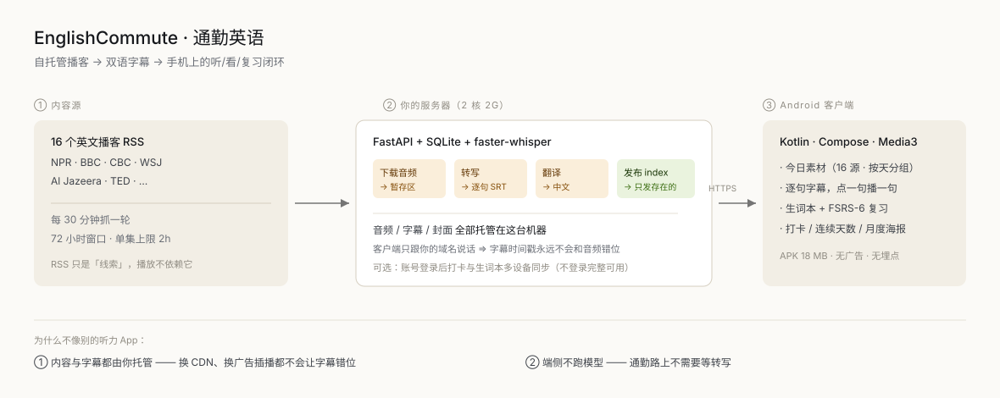

# EnglishCommute · 通勤英语

**把通勤 20 分钟变成一个学习循环。** 自托管的播客流水线：把 16 个英文播客源转成**逐句双语字幕**，
再用一个 Android App 把「听 → 看 → 复习」串成闭环。

[English](README.md) · **中文** · [架构](docs/ARCHITECTURE.md) · [署名](ATTRIBUTION.md) · MIT

<p align="center"></p>

## 为什么不用现成的

大多数听力 App 是「播放器 + 找得到的字幕文件」。这个项目**自己拥有整条流水线**：

| | 常见做法 | 本项目 |
| --- | --- | --- |
| 字幕 | 等发布方提供，经常没有或对不上 | **自己转写自己托管的那份音频** |
| 音频 | 直连第三方 CDN（广告被重新拼接 → 时间戳漂移） | **从你的域名出** |
| 端侧模型 | 下载 100–700 MB，每集等几分钟 | **没有 —— APK 18 MB** |
| 数据 | 各种统计 SDK | **只存本机；无广告、无埋点** |
| 成本 | 订阅费 | **一台 5 美元的 VPS**（2 核 2G 够用） |

重点不是「离线」，而是：**你听到的音频和你读到的字幕是同一份字节** ——
所以「点一句重播」「循环一句」「按句子选词」才真的对得上。

## 功能

- **16 个源，一次抓取** —— NPR、BBC、CBC、WSJ、Al Jazeera、TED 等；服务端每 30 分钟一轮。
- **逐句字幕 + 中文翻译** —— 服务端用 faster-whisper 转写并翻译，发布成普通 `.srt`（可读可改）。
- **点一句播一句**，可循环、可跳下一句。
- **生词本 + FSRS-6** —— 长按字幕里的词：查词形、带上它出现的那句话，然后间隔复习
  （正面认词，背面例句 + 读音 + 原声）。
- **打卡与连续天数** —— 收听时长本地累计，日历 / 连续天数 / 月度海报。
- **多设备同步（可选）** —— 登录后打卡与生词本跨设备；不登录完整可用。

## 快速开始

**只跑 App**（不接服务器 —— 会退回本机解析 RSS，没有字幕）：

```bash
./gradlew :app:assembleDebug
```

**接自己的服务器：**

```bash
# 1. 打包时把服务器地址传进去（不要改源码里的字符串）
./gradlew :app:assembleDebug -PserverBaseUrl=https://your-domain.example

# 2. Debian/Ubuntu（python3.11+ / ffmpeg / nginx）：
cp -r server /opt/ec
python3 -m venv /opt/ec/venv && /opt/ec/venv/bin/pip install -r server/api/requirements.txt
/opt/ec/venv/bin/python server/api/init_db.py
EC_PUBLIC_BASE=https://your-domain.example /opt/ec/venv/bin/python server/bin/cycle.py --dry-run
```

完整部署（nginx、systemd、证书、备份）见 [`server/README.md`](server/README.md)。

部署前要知道的两条约束：

- **`--workers 1`** —— 登录限速是进程内状态，多开会变成「上限 × N」而且不报错。
- 若保留 IP 应急更新通道，它必须与 `publish_update.py` 的 `FALLBACK_BASE_URL` **一致**。

## 仓库结构

```
app/      Android 客户端 —— content/（目录→本地索引→懒加载）、player/（Media3 + 字幕同步）、
          word/（FSRS-6）、checkin/、sync/（可选账号）、notify/（后台字幕预加载）
server/   FastAPI + SQLite；api/（账号、同步、清单）、bin/（cycle.py 流水线与发布/管理脚本）、
          nginx/（反代 + 静态资源，模板）
tools/    构建期断言（见 docs/工程约定-构建与验证.md —— 为什么「永远为真的断言比没有更糟」）
docs/     架构、界面约定、工程约定
```

## 常见问题

**为什么不直接用发布方的字幕？** 很多节目根本没有；有些提供的是**另一版拼接**的音频对应的字幕
（广告插得不一样），那比没有更糟 —— 时间戳在说谎。转写你实际提供的那份文件，是唯一能保证对齐的做法。

**为什么包名是 `com.example.englishcommute`？** 这是脱敏后的模板：不含真实域名、服务器、账号与个人信息。
自己用请改 `applicationId`。

**不接服务器能用吗？** 能，但降级：自己解析 RSS、能播放 —— 没有字幕、没有中文、没有生词复习。

**为什么没有推送提醒？** 国内厂商推送要企业资质，FCM 要 GMS；本地闹钟在激进 ROM 上又活不下来。
所以 4.7.0 把提醒**删掉**了，而不是留一个不响的功能。进度改由首页刊头承担。

## 已知取舍

- 同一条内容在两台设备上听，时长会各记一份（服务端按设备求和）。
- 同一个词的例句在不同设备上可能不同：合并时**刻意保留本机顺序**，不重排用户看惯的那句。
- 服务端是单点：它挂了 App 退回本机 RSS。

## License

- **代码**：[MIT](LICENSE)。
- **随仓库分发的第三方数据**：词库来自 [ECDICT](https://github.com/skywind3000/ECDICT)（MIT），
  例句来自 [Tatoeba](https://tatoeba.org)（CC BY 2.0 FR），FSRS 参考实现来自
  [py-fsrs](https://github.com/open-spaced-repetition/py-fsrs)（MIT）—— 完整署名见 [ATTRIBUTION](ATTRIBUTION.md)。
- **播客内容**（音频、封面、其对音频的转写）**不在本仓库**，版权归各发布方，仅供个人学习；
  对外提供服务前请自行确认条款。
